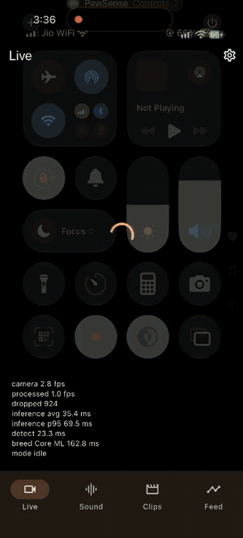
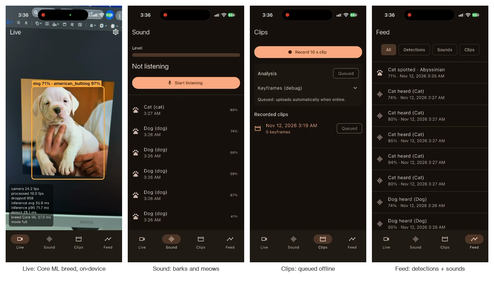
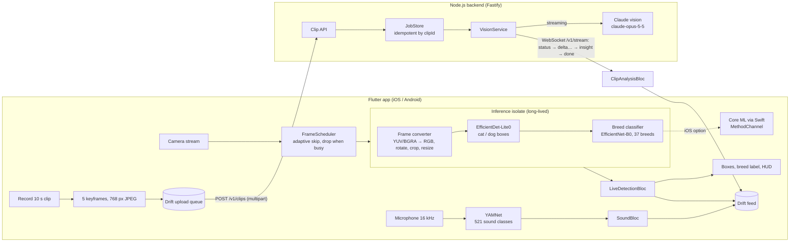
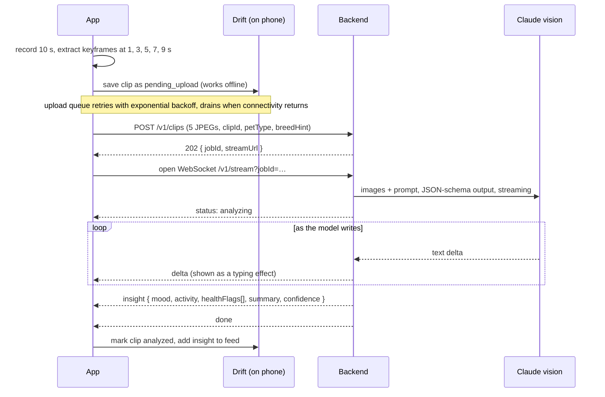
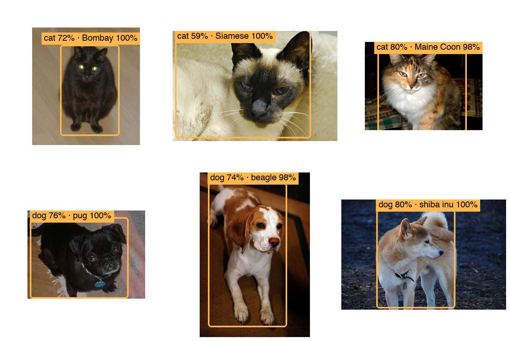
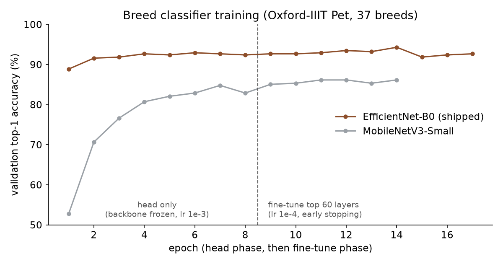
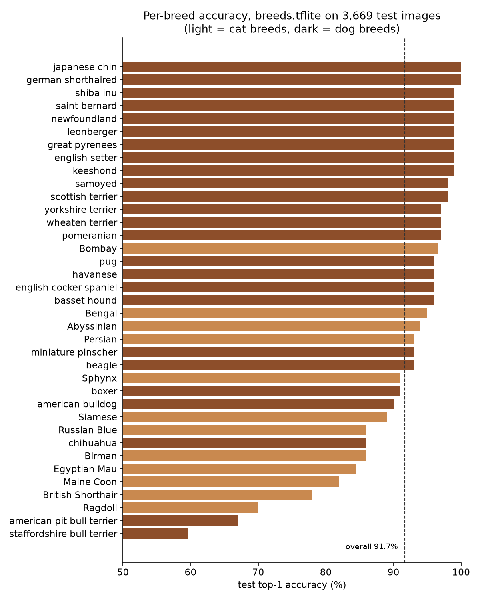

# PawSense

[](https://github.com/elysian12/pawsense/actions/workflows/app-ci.yml)
[](https://github.com/elysian12/pawsense/actions/workflows/backend-ci.yml)


**An AI companion app for pet parents that sees, hears and understands your cat or dog — on-device first.**

Point the camera at your pet and PawSense draws a box around it and names its breed in real time,
entirely on the phone. It listens for barks and meows with an on-device sound model. Record a
10-second clip and a cloud vision model (Claude) describes your pet's mood, activity and any visible
health concerns, streaming the answer back word by word. Everything is saved to an offline-first
feed, and clips wait in a queue until the network returns.

<p align="center">
  
</p>

<p align="center"><sub>Screen recording from an iPhone 17 (profile build). The camera is pointed at
a held-out test photo on a monitor: "dog 71%" is the on-device detector, "american_bulldog 97%" the
breed classifier running on <b>Core ML</b>. The HUD shows camera fps, processed fps and per-model
milliseconds live.</sub></p>



---

## Contents

- [What it does](#what-it-does)
- [How it works](#how-it-works)
- [The three on-device models](#the-three-on-device-models)
- [How the breed classifier was trained](#how-the-breed-classifier-was-trained)
- [Results](#results)
- [Engineering decisions](#engineering-decisions)
- [Bugs found on real devices](#bugs-found-on-real-devices)
- [Tech stack](#tech-stack)
- [Run it](#run-it)
- [Testing](#testing)
- [CI/CD and release](#cicd-and-release)
- [Repository layout](#repository-layout)
- [Credits and licenses](#credits-and-licenses)

## What it does

| Tab | What happens | Where it runs |
|---|---|---|
| **Live** | Detects cats and dogs in the camera feed, draws boxes, names the breed (37 breeds), shows a debug HUD with fps and inference ms | On-device (TFLite; Core ML option on iOS) |
| **Sound** | Listens to the microphone and logs barks and meows | On-device (YAMNet) |
| **Clips** | Records 10 s, extracts 5 keyframes, uploads them, streams back mood, activity, health flags and a summary | Keyframes on-device, analysis in the cloud |
| **Feed** | Every detection, sound and clip insight, filterable, available offline | On-device database (Drift/SQLite) |
| **Settings** | Breed engine (TFLite vs Core ML), HUD, adaptive frame skipping, detection threshold, a built-in 10-minute battery test | — |

## How it works

### System overview



### 1. Live detection, frame by frame

1. **Camera** delivers frames at about 30 fps (YUV420 on Android, BGRA on iOS).
2. **FrameScheduler** decides whether to process this frame. While one frame is in flight, new frames
   are **dropped, never queued**, because a queue only adds latency. It targets
   `max(33 ms, avg inference × 1.5)` and slows to about 2 fps after 5 s with no pet, below 20 %
   battery, or when the phone is hot. The first detection snaps it back to full rate.
3. The frame is copied into **one long-lived inference isolate** (a background Dart thread that owns
   all the TFLite interpreters, so the UI never stutters).
4. **Frame converter**, in a single fused pass per output pixel: YUV/BGRA → RGB, rotation to upright,
   crop, and resize to the model's input size.
5. **EfficientDet-Lite0** (320×320 input) returns up to 25 boxes. PawSense keeps only `cat` and `dog`
   above the score threshold.
6. For the top box, the region plus a 10 % margin is cropped and stretched to 224×224 and sent to the
   **breed classifier**. To save battery it runs on the first box, then every 5th frame or when the
   box moves; an exponential moving average (α = 0.3) smooths the label so it doesn't flicker.
7. **LiveDetectionBloc** emits the result; a `CustomPainter` maps the normalized box onto the
   preview (accounting for `BoxFit.cover` cropping) and draws it. The HUD shows camera fps, processed
   fps, dropped frames, inference avg/p95, and per-model ms.
8. A detection is written to the feed at most once per pet type per minute.

On iOS, Settings can switch the breed classifier to **Core ML**: the crop is sent as JPEG over a
`MethodChannel` to Swift, where Vision runs the same model on the Neural Engine.

### 2. Bark and meow detection

1. The `record` package streams the microphone as 16 kHz mono PCM16.
2. Audio is cut into 0.975 s windows (15,600 samples) with 50 % overlap and scaled to [-1, 1].
3. **YAMNet** scores 521 AudioSet classes per window. PawSense takes the max over the dog classes
   (`Dog`, `Bark`, `Yip`, `Howl`, `Bow-wow`, `Growling`, `Whimper (dog)`) and the cat classes (`Cat`,
   `Purr`, `Meow`, `Hiss`, `Caterwaul`).
4. A **debouncer** fires an event only when two windows in a row score ≥ 0.3, then stays quiet for
   3 s, so one barking fit is one feed entry, not twenty.

### 3. Clip analysis, streamed



- **Keyframes, not video:** five 768 px JPEGs (quality 80) are a few hundred KB, upload fast and are
  what the vision model needs.
- **Idempotent and resumable:** the app generates the `clipId`, so a retried upload never creates a
  duplicate job. A dropped socket reconnects by `jobId`, and finished results are replayed for 15 min.
- **Safe output:** the prompt allows only what is visible in the frames, requires evidence for each
  health flag, says to see a vet for anything concerning, treats the on-device breed as a hint, and
  answers `unknown` when unsure. A JSON schema constrains the final insight.
- **Secrets stay on the server:** the Anthropic API key lives only in the backend's `.env`; the app
  holds just a shared bearer token. Full wire format: [`docs/WS_PROTOCOL.md`](docs/WS_PROTOCOL.md).

## The three on-device models

| Model | Job | Input → output | Size | Origin |
|---|---|---|---|---|
| **EfficientDet-Lite0** | Find cats and dogs | `uint8 [1,320,320,3]` → 25 boxes, classes, scores (COCO: 16 = cat, 17 = dog) | 4.6 MB | Pretrained on COCO, downloaded from Kaggle Models (Apache-2.0) |
| **Breed classifier** (EfficientNet-B0) | Name the breed | `float32 [1,224,224,3]`, raw 0–255 → 37 probabilities | 8.2 MB TFLite / 8.4 MB Core ML | **Trained for this project** (below) |
| **YAMNet** | Hear barks and meows | `float32 [15600]` @ 16 kHz → 521 AudioSet scores | 4.1 MB | Pretrained on AudioSet, downloaded from Kaggle Models (Apache-2.0) |

Download sources and sha256 hashes for every model file: [`ml/README.md`](ml/README.md).



<sub>The two shipped models (`efficientdet_lite0.tflite` → `breeds.tflite`) on photos from the
Oxford-IIIT Pet **test split**, which the classifier never saw during training, run offline in
Python with the app's preprocessing: "cat 72%" is the detector's confidence, "Bombay 100%" the breed
classifier's. One example per breed, picked where the prediction was right; the honest per-breed
accuracy is in the chart under [Results](#results).</sub>

## How the breed classifier was trained

**Dataset:** [Oxford-IIIT Pet](https://www.robots.ox.ac.uk/~vgg/data/pets/), 37 breeds (12 cats,
25 dogs), loaded with `tensorflow_datasets`: 3,680 `train` images, split 90 % / 10 % into train and
validation, and 3,669 `test` images that are used **once**, at the very end.

**Method: transfer learning in two phases.** Start from an ImageNet-pretrained backbone, which already
knows edges, fur and faces, and teach it only the breed distinctions:

1. **Head only.** Freeze the backbone and train a new head (global average pooling → dropout 0.3 →
   37-way softmax) with Adam at 1e-3.
2. **Fine-tune.** Unfreeze the top 60 backbone layers and continue at Adam 1e-4. BatchNorm layers
   stay frozen in inference mode so a small dataset can't wreck their ImageNet statistics. Early
   stopping on validation top-1 (patience 3) restores the best weights.

**Augmentation (deliberately light):** random zoom-crop (resize to 224–280, random 224 crop),
horizontal flip, ±20 brightness, 0.85–1.15 contrast. Images are **stretched** to 224×224 rather than
center-cropped, because the app stretches the detector's box the same way, so training matches
inference.

**Preprocessing lives inside the model.** EfficientNet-B0's rescaling and ImageNet normalization are
the model's first layers, so Dart, Swift and Python all feed the same raw 0–255 pixels. Mismatched
preprocessing is the most common on-device ML bug, and this removes it by construction.

**Backbone comparison.** Both candidates were trained with the identical recipe on an Apple M4
MacBook (TensorFlow 2.21, CPU only):



| Backbone | Params | Test top-1 | Test top-5 | Training time |
|---|---|---|---|---|
| MobileNetV3-Small | 0.96 M | 84.3 % | 98.7 % | 1.4 min |
| **EfficientNet-B0 (shipped)** | 4.10 M | **91.6 %** | **99.6 %** | 7.7 min |

EfficientNet-B0 is 7.3 points more accurate. Because the classifier only runs on every 5th
processed frame, its extra cost matters much less than the accuracy.

**Export to two runtimes, verified.** The same Keras model is exported to **TFLite float16**
(Android and iOS) and **Core ML float16** (iOS, can use the Neural Engine). Every export is
re-evaluated on the full test set, so a broken conversion can't ship unnoticed. That check caught a
real problem: converting a Keras 3 model through a wrapped `tf.function` silently dropped the
weights (8 MB → 0.3 MB, 2.7 % accuracy). The scripts now export through
`model.export(format="tf_saved_model")` first.

| Format | Size | Test top-1 | Test top-5 |
|---|---|---|---|
| Keras float32 (reference) | — | 91.66 % | 99.56 % |
| TFLite float16 (`breeds.tflite`) | 8.2 MB | 91.66 % | 99.56 % |
| Core ML float16 (`BreedClassifier.mlpackage`) | 8.4 MB | 91.69 % | 99.56 % |

float16 cost nothing measurable; the 0.03-point Core ML difference is one image out of 3,669.
Reproduce everything with the commands in [Run it → ML](#ml-python-311-optional) or step through
`ml/train_breed_classifier.ipynb`.

## Results

### Accuracy per breed



Computed with the shipped `breeds.tflite` over all 3,669 test images, with the same decoding and
resizing as the training evaluation (overall **91.66 %**, matching the table above). The weak spots
are breeds that people confuse too:

| True breed | Predicted as | Test images |
|---|---|---|
| Ragdoll | Birman | 19 |
| American pit bull terrier | American bulldog | 16 |
| Egyptian Mau | Bengal | 13 |
| Birman | Ragdoll | 12 |
| Staffordshire bull terrier | American pit bull terrier | 12 |
| Staffordshire bull terrier | American bulldog | 11 |

Ragdoll and Birman are both colour-pointed, long-haired cats; the three bull-terrier-type dogs differ
mainly in build and size, which a single photo shows poorly. Nine breeds score 99–100 %.

### Performance

Measured here: app size. Everything that depends on the phone is listed with its exact procedure in
[`docs/METRICS.md`](docs/METRICS.md) and will be filled in from a real device — no number below is
estimated.

| Metric | Android | iOS |
|---|---|---|
| Release build size | **47.3 MB** (arm64-v8a APK) | **60.4 MB** installed, 35.3 MB zipped IPA |
| Detection inference, EfficientDet-Lite0 (median / p95 ms) | TBD — measure on device | TBD — measure on device |
| Breed classification, TFLite (median / p95 ms) | TBD — measure on device | TBD — measure on device |
| Breed classification, Core ML (median / p95 ms) | n/a (iOS only) | TBD — measure on device |
| Camera fps with detection running | TBD — measure on device | TBD — measure on device |
| Battery, 10 min live detection, adaptive skipping off → on | TBD — measure on device | TBD — measure on device |
| Time to first insight token, clip analysis | TBD — measure on device | TBD — measure on device |
| Cold start to first frame | TBD — measure on device | TBD — measure on device |

The three models are 16.9 MB of each app; iOS also carries the 8.2 MB Core ML copy of the breed
model.

**First look on an iPhone 17** (profile build, Core ML breed engine, read off the HUD in the
recording above): camera 24 fps, 10–13 frames/s through the models, detection 16.5–25.1 ms, Core ML
breed classification about 37 ms including the crop, JPEG encode and method channel, per-frame
inference average about 36 ms and p95 71.7 ms. These come from a single 16-second screen recording,
which itself costs CPU and GPU, so they stay out of the table until the full procedure in
`docs/METRICS.md` is run.

## Engineering decisions

- **One long-lived inference isolate, not `compute()` per frame.** Spawning an isolate and rebuilding
  an interpreter (model parse, GPU/Metal delegate compile, warm-up) every frame would eat the whole
  33 ms budget. One isolate owns all three interpreters; only frames and results cross the boundary.
- **GPU first, CPU fallback, decided at load time.** Each model tries the GPU delegate (Android) or
  Metal (iOS), runs a warm-up inference to prove it works, and otherwise falls back to the CPU path,
  which TFLite accelerates with XNNPACK automatically.
- **Drop frames, adapt the rate.** Covered in [Live detection](#1-live-detection-frame-by-frame). The
  10-minute before/after battery test is built into Settings so the saving can be measured, not
  claimed.
- **Same model, two runtimes.** TFLite works everywhere; Core ML can reach Apple's Neural Engine,
  which TFLite cannot. Keeping both behind one `BreedClassifier` interface makes the comparison a
  settings toggle.
- **Offline-first.** Every result is written to Drift first, and the UI only reads Drift streams.
  Clips go through a persistent upload queue (exponential backoff capped at 5 min, no attempt limit)
  that drains when connectivity returns, and uploads resume after the app is killed.
- **Stream, don't wait.** The user sees the analysis being written after the first token instead of
  staring at a spinner for the whole answer.
- **Clean architecture per feature.** `data / domain / presentation` per feature, BLoC for state,
  `get_it` for dependency injection with test fakes swapped in at bootstrap, `go_router` with a
  stateful shell for the four tabs.

Full decision records: [`docs/ARCHITECTURE.md`](docs/ARCHITECTURE.md).

## Bugs found on real devices

Three bugs that unit tests and simulators did not show, found by running on an Android emulator and
an iPhone 17:

1. **Explicit XNNPACK delegate crashed natively on Android.** When the GPU delegate failed (as it
   does on an emulator), creating an `XNNPackDelegate` with options segfaulted inside
   `tflite_flutter`, killing the app with no Dart exception to catch. Fix: drop the explicit delegate,
   because TFLite's CPU path already applies XNNPACK by default.
2. **Boxes in the wrong place on iPhone.** The iOS camera plugin already rotates the image stream to
   the device orientation, and the code rotated it another 90° using the sensor angle. The detector
   saw pets sideways, boxes came back transposed, and a black cat read as "dog". Fix: rotation 0 on
   iOS, sensor rotation on Android, where CameraX delivers frames unrotated.
3. **Queued clips failed after an app update on iOS.** Keyframe paths were stored as absolute paths,
   which include the app's data-container ID, and iOS changes that ID on every update or reinstall.
   Fix: store paths relative to the Documents folder; old rows are re-rooted when read.

## Tech stack

| Layer | Choices |
|---|---|
| App | Flutter 3.47, Dart 3.13, `flutter_bloc`, `go_router`, `get_it`, `drift` (SQLite), `dio`, `web_socket_channel`, `camera`, `record`, `tflite_flutter`, `sentry_flutter`, `very_good_analysis` lints |
| iOS native | Swift `MethodChannel` → Vision + Core ML |
| ML | Python 3.11 (`uv`), TensorFlow 2.21 / Keras 3, `tensorflow-datasets`, `coremltools` 9 |
| Backend | Node 26, TypeScript, Fastify 5, `@fastify/websocket`, `@fastify/multipart`, zod, `@anthropic-ai/sdk`, vitest, Docker |
| CI/CD | GitHub Actions (app, backend, release-android, release-ios), Fastlane, GHCR |
| Monitoring | Sentry errors plus performance spans for inference, upload and WebSocket |

## Run it

### App (Flutter, iOS 16+ / Android 8.0+)

```bash
cd app
cp dart_defines.example.json dart_defines.json   # API_BASE_URL, API_TOKEN (same as the backend)
flutter pub get
dart run build_runner build --delete-conflicting-outputs   # Drift code
flutter run -t lib/main_development.dart --dart-define-from-file=dart_defines.json
```

- On a physical phone, set `API_BASE_URL` to your Mac's LAN address (for example
  `http://192.168.1.6:8080`). iOS allows plain HTTP to the local network only, and asks for
  Local Network permission the first time.
- On a real iPhone use `--profile` or `--release`: debug builds only run while attached to a debugger.
- Run CocoaPods with `LANG=en_US.UTF-8` on macOS.

### Backend (Node 26)

```bash
cd backend
cp .env.example .env    # API_TOKEN (long random string) and ANTHROPIC_API_KEY — never commit this file
npm ci
npm run dev             # http://localhost:8080, or: docker compose up --build
```

### ML (Python 3.11, optional)

The exported models are committed, so this is only needed to retrain.

```bash
cd ml
uv venv --python 3.11 .venv
uv pip install --python .venv/bin/python tensorflow tensorflow-datasets coremltools numpy pillow importlib_resources
.venv/bin/python train.py            # downloads the dataset (~800 MB), trains EfficientNet-B0
.venv/bin/python export_tflite.py    # writes breeds.tflite + breeds.txt into the app
.venv/bin/python export_coreml.py    # writes BreedClassifier.mlpackage (macOS only)
```

### Testing on a phone with sample photos and sounds

- **Photos:** show held-out test photos (any from the Oxford-IIIT Pet `test` split) full-screen on a
  monitor and point the phone at them. The breed is in each file name.
- **Sounds:** play dog and cat clips from the [ESC-50](https://github.com/karolpiczak/ESC-50) dataset
  near the phone with the Sound tab listening. Each ESC-50 dog clip scores 0.89–0.97 and each cat clip
  0.74–0.99 on the shipped YAMNet; a single short bark moves the meter but needs about a second of
  sound to become an event.

These datasets have their own licenses (below), so the sample files are kept out of the repo.

## Testing

```bash
cd app && flutter analyze && flutter test     # 90 unit, bloc and widget tests
cd app && flutter test integration_test       # 2 end-to-end flows on a device or emulator
cd backend && npm run lint && npm test        # 23 tests, Claude vision mocked
```

- **E2E flow 1:** onboarding → Live tab → a (faked) detection appears.
- **E2E flow 2:** record a clip **offline** → it shows *Queued* → the network returns → the upload
  drains → the streamed insight arrives → it appears in the Feed.
- Backend tests mock the vision call, so CI never needs an API key.

## CI/CD and release

| Workflow | What it does |
|---|---|
| `app-ci` | analyze, unit tests, then E2E on an Android emulator |
| `backend-ci` | lint, tests, Docker build, push to GHCR, deploy over SSH |
| `release-android` | Fastlane `internal` → Play internal testing |
| `release-ios` | Fastlane `beta` → TestFlight |

Secrets and the one-time store setup are listed in [`docs/RELEASE.md`](docs/RELEASE.md).

## Repository layout

| Path | What |
|---|---|
| `app/lib/ml/` | Inference isolate, frame converter, detector, breed classifiers, YAMNet, frame scheduler |
| `app/lib/features/` | `onboarding`, `live_detection`, `sound`, `clip_analysis`, `insights_feed`, `settings` (each `data / domain / presentation`) |
| `app/lib/data/` | Drift database, REST + WebSocket clients, sync service |
| `app/ios/Runner/` | Core ML model and the Swift `MethodChannel` |
| `backend/` | Fastify API, job store, Claude vision service |
| `ml/` | Training script, notebook, TFLite and Core ML export |
| `docs/` | Architecture decisions, metrics procedure, WebSocket protocol, release guide |

## Credits and licenses

- Code: MIT.
- [Oxford-IIIT Pet Dataset](https://www.robots.ox.ac.uk/~vgg/data/pets/) (Parkhi et al., 2012),
  CC BY-SA 4.0: used to train the breed classifier. `docs/images/detections.jpg` is made from its test
  photos and is shared under the same license.
- EfficientDet-Lite0 and YAMNet: Google, Apache-2.0, via Kaggle Models.
- [ESC-50](https://github.com/karolpiczak/ESC-50) (Piczak, 2015), CC BY-NC 3.0: used only for local
  sound testing, not included.
